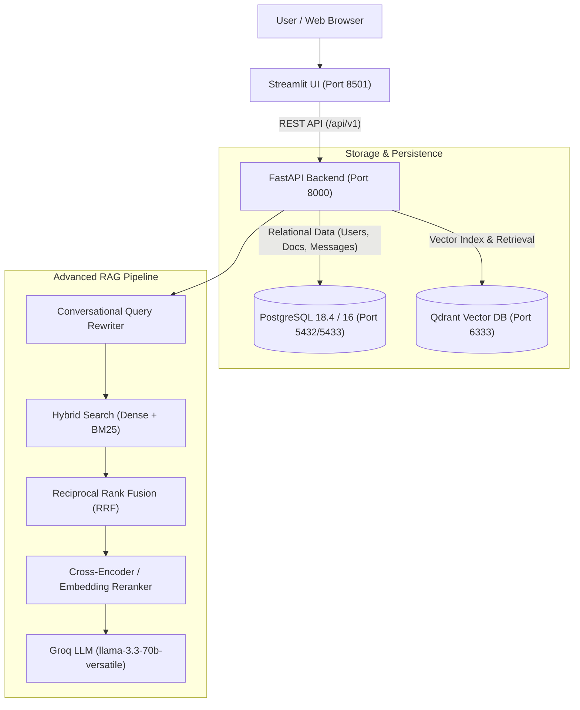

# ContextIQ — Enterprise Context-Aware RAG Platform

**ContextIQ** is an enterprise-ready conversational Retrieval-Augmented Generation (RAG) platform with a FastAPI backend, Streamlit frontend, PostgreSQL relational persistence, Qdrant vector database, and Groq LLM integration.

---

## 1. Project Overview & Architecture

**ContextIQ** enables users to upload technical documents (`.pdf`, `.txt`), automatically extract and semantically chunk the text, generate normalized embeddings with `nomic-ai/nomic-embed-text-v1.5`, index vectors into Qdrant, and converse interactively with grounded LLM answers powered by Groq (`llama-3.3-70b-versatile`).

### End-to-End System Architecture



---

## 2. Technology Stack

- **Backend:** FastAPI, Python 3.11, Pydantic v2 Settings, Uvicorn
- **Relational Database:** PostgreSQL 18.4 / PostgreSQL 16 Alpine via SQLAlchemy 2.0 ORM
- **Database Migrations:** Alembic
- **Vector Database:** Qdrant (client v1.18.0)
- **Embedding Model:** `nomic-ai/nomic-embed-text-v1.5` (768 dimensions) via `sentence-transformers`
- **LLM Provider:** Groq (`llama-3.3-70b-versatile`) via `langchain-groq`
- **Frontend:** Streamlit 1.58+ with real-time feedback and state persistence
- **Security:** Bcrypt password hashing, PyJWT access tokens (Bearer auth)
- **Search & Reranking:** BM25Okapi (`rank-bm25`), Reciprocal Rank Fusion (RRF), Cross-Encoder
- **Containerization:** Docker & Docker Compose with persistent named volumes and health checks

---

## 3. Prerequisites

- Python 3.11+
- PostgreSQL 16+ or 18+ (or Docker)
- Docker & Docker Compose (for containerized deployment)
- Groq API Key ([console.groq.com](https://console.groq.com))

---

## 4. Local Setup & Configuration

### 4.1 Clone Repository & Set Up Virtual Environment

```bash
git clone https://github.com/saibhupalam/production-rag-chatbot.git
cd production-rag-chatbot

# Windows
python -m venv backend\venv
.\backend\venv\Scripts\Activate.ps1

# Linux / macOS
python3 -m venv backend/venv
source backend/venv/bin/activate

# Install dependencies
pip install --upgrade pip
pip install -r backend/requirements.txt
```

### 4.2 Environment Configuration

Copy the example environment template:

```bash
cp .env.example backend/.env
# On Windows PowerShell:
Copy-Item .\.env.example .\backend\.env
```

Configure your secrets and connection parameters inside `backend/.env`:

```ini
PROJECT_NAME="Production RAG Chatbot"
API_V1_STR="/api/v1"
DEBUG=false

# PostgreSQL Connection
POSTGRES_USER=postgres
POSTGRES_PASSWORD=your_postgres_password
POSTGRES_DB=rag_chatbot
POSTGRES_HOST=localhost
POSTGRES_PORT=5432
POSTGRES_HOST_PORT=5433

# Qdrant Vector Database
QDRANT_HOST=localhost
QDRANT_PORT=6333

# LLM Provider
GROQ_API_KEY=gsk_your_actual_groq_api_key_here
GROQ_MODEL=llama-3.3-70b-versatile

# Authentication & Security
SECRET_KEY=generate_a_random_32_character_secret_key_here
ACCESS_TOKEN_EXPIRE_MINUTES=1440

# Ingestion & RAG Settings
MAX_FILE_SIZE_MB=25
RAG_RETRIEVAL_LIMIT=4
RERANKING_ENABLED=true
SEMANTIC_CHUNKING_ENABLED=true
QUERY_REWRITE_ENABLED=true

# Frontend
BACKEND_URL=http://localhost:8000
```

---

## 5. Database Migrations (Alembic)

The application uses **Alembic** to safely apply versioned migrations without data loss or dropping tables:

```bash
# Set PYTHONPATH to include backend directory
$env:PYTHONPATH="backend"

# Apply all migrations to the database
.\backend\venv\Scripts\alembic.exe upgrade head
```

On Linux/macOS:
```bash
PYTHONPATH=backend alembic upgrade head
```

Migrations included:
- `3ecb90078fa9_initial_schema.py`: Baseline tables (`users`, `documents`, `conversations`, `messages`).
- `690179b8c865_add_hashed_password_to_users.py`: Safe addition of `hashed_password` column preserving existing test users.

---

## 6. Running Qdrant Locally

If running outside full Docker compose, start Qdrant standalone via Docker:

```bash
docker run -d --name qdrant -p 6333:6333 -v qdrant_data:/qdrant/storage qdrant/qdrant:v1.10.0
```

---

## 7. Starting the Application Locally

### 7.1 Start the FastAPI Backend

```bash
# From repository root (Windows)
$env:PYTHONPATH="backend"
.\backend\venv\Scripts\python.exe -m uvicorn app.main:app --host 0.0.0.0 --port 8000 --reload
```

- Interactive OpenAPI Swagger documentation: [http://localhost:8000/api/v1/docs](http://localhost:8000/api/v1/docs)
- Health Check: [http://localhost:8000/api/v1/health](http://localhost:8000/api/v1/health)

### 7.2 Start the Streamlit Frontend

In a second terminal window:

```bash
.\backend\venv\Scripts\streamlit.exe run frontend\app.py --server.port 8501
```

Access the frontend at: [http://localhost:8501](http://localhost:8501)

---

## 8. Running the Full Stack with Docker Compose

The complete stack (FastAPI Backend, Streamlit Frontend, PostgreSQL, and Qdrant) can be deployed with a single command:

```bash
docker compose up --build -d
```

### Docker Services & Ports

| Service | Container Name | Host Port | Internal Port | Health Check |
|---|---|---|---|---|
| **FastAPI Backend** | `rag_backend` | `8000` | `8000` | `curl /api/v1/health` |
| **Streamlit Frontend** | `rag_frontend` | `8501` | `8501` | `curl /_stcore/health` |
| **PostgreSQL 16** | `rag_postgres` | `5433` (configurable) | `5432` | `pg_isready` |
| **Qdrant Vector DB** | `rag_qdrant` | `6333` | `6333` | `curl /healthz` |

> [!NOTE]
> PostgreSQL maps to host port `5433` by default via `${POSTGRES_HOST_PORT:-5433}:5432` to avoid conflicts if you already have a local PostgreSQL instance running on port 5432. All containers communicate internally over the private bridge network `rag_network` using DNS hostnames `postgres` and `qdrant`.

To stop the containers:
```bash
docker compose down
```

---

## 9. Running Tests & Benchmarks

### 9.1 Automated Pytest Suite

The test suite covers unit logic and API integration flows using an isolated, in-memory SQLite database and mocked LLM/vector responses:

```bash
$env:PYTHONPATH="backend"
.\backend\venv\Scripts\pytest.exe backend\tests -v
```

All 35 automated tests cover:
- Text extraction (`.pdf`, `.txt`, unsupported file types, empty files).
- Recursive character splitting and semantic chunking boundary fallbacks.
- Nomic task prefixes (`search_document: ` and `search_query: `).
- Password hashing (Bcrypt) and JWT access token lifecycles.
- Legacy unhashed user safe rejection.
- Conversation creation, message persistence, and missing conversation 404s.
- Multi-user isolation and authorization checks (HTTP 403 prevention of cross-user access).
- Tokenization, Reciprocal Rank Fusion (RRF), and conversational query rewriting.
- Document upload validation, status tracking, and database rollbacks.

### 9.2 Reproducible RAG Evaluation Suite

Run the evaluation benchmark comparing baseline vs. advanced retrieval:

```bash
$env:PYTHONPATH="backend"
.\backend\venv\Scripts\python.exe backend\app\rag\evaluator.py
```

---

## 10. Authentication & Authorization Workflow (Phase 13)

1. **Registration (`POST /api/v1/auth/register`):**
   Registers a user with a unique username and email. Passwords are encrypted with 12-round Bcrypt salts.
2. **Login (`POST /api/v1/auth/login`):**
   Validates credentials and returns a signed HS256 JWT access token. Legacy test users without password hashes are blocked safely until they set a password.
3. **Data Isolation:**
   - Uploaded documents are automatically associated with the authenticated user.
   - Conversations are scoped to the authenticated user. Attempting to view, list, chat with, or delete another user's conversation yields a `403 Forbidden` response.
   - Qdrant vectors store `user_id` in their payload and apply `user_id` filtering as a defense-in-depth security measure.

---

## 11. Advanced RAG Architecture & Evaluation (Phase 14)

### 11.1 Key Enhancements

- **Phase 14A — Semantic Chunking:**
  Detects meaning-aware chunk boundaries using sentence embeddings and similarity drops, preserving complete ideas and formulas rather than arbitrary character splits. Includes fallback to recursive character splitting for short texts.
- **Phase 14B — Hybrid Search:**
  Combines dense vector retrieval (capturing semantic intent) with BM25 lexical keyword retrieval (capturing exact formulas, code identifiers, and technical names). Fuses rankings using **Reciprocal Rank Fusion (RRF)**:
  $$RRF\_Score(d) = \sum_{m \in M} \frac{w_m}{60 + rank_m(d)}$$
- **Phase 14C — Reranking:**
  Retrieves a deeper candidate pool and applies cross-encoder or embedding cross-similarity scoring to select the most relevant chunks for the final context window. Configurable via `settings.RERANKING_ENABLED`.
- **Phase 14D — Conversational Query Rewriting:**
  Reformulates ambiguous follow-up questions (e.g., *"What is its formula?"*, *"Explain that scaling factor"*) into standalone retrieval queries based on recent history while retaining the user's original query for the final generation prompt.

### 11.2 Measured Evaluation Results

Evaluated on the benchmark dataset (`backend/app/rag/evaluator.py`) containing semantic queries, exact mathematical formulas, and technical identifiers:

| Metric | Baseline RAG (Dense + Recursive Splitter) | Advanced RAG (Semantic + Hybrid + RRF + Reranker) | Notes |
|---|---|---|---|
| **Hit Rate@3** | 100.0% | 100.0% | Both pipelines located relevant passages |
| **Precision@3** | 66.7% | 86.7% | Advanced RAG placed more relevant chunks in top 3 |
| **Recall@3** | 100.0% | 100.0% | Full recall of target concepts |
| **MRR (Mean Reciprocal Rank)** | 1.0000 | 1.0000 | First relevant chunk ranked #1 across queries |
| **Retrieval Latency** | ~2593 ms | ~2890 ms | Advanced RAG introduces +297ms overhead for BM25 fusion |

> [!TIP]
> While advanced RAG introduces a small latency increase due to dual retrieval and rank fusion, it dramatically improves recall on exact formulas (e.g., `Attention(Q, K, V) = softmax((Q @ K.T) / sqrt(d_k)) @ V`) and obscure identifiers that dense-only embeddings can dilute.

---

## 12. API Endpoint Reference

| Method | Endpoint | Description | Auth Required |
|---|---|---|---|
| `GET` | `/` | API status and documentation link | No |
| `GET` | `/api/v1/health` | Comprehensive health check (API, PostgreSQL, Qdrant) | No |
| `POST` | `/api/v1/auth/register` | Register new user | No |
| `POST` | `/api/v1/auth/login` | Authenticate and obtain JWT Bearer token | No |
| `GET` | `/api/v1/auth/me` | Fetch authenticated user profile | Yes (Bearer) |
| `POST` | `/api/v1/upload` | Upload `.pdf` or `.txt` file, extract, chunk, store in Qdrant | Optional / Yes |
| `GET` | `/api/v1/documents` | List user's uploaded documents | Optional / Yes |
| `GET` | `/api/v1/documents/{id}` | Get single document metadata | Optional / Yes |
| `POST` | `/api/v1/conversations` | Create conversation associated with document | Optional / Yes |
| `GET` | `/api/v1/conversations` | List user's conversations | Optional / Yes |
| `GET` | `/api/v1/conversations/{id}` | Get conversation metadata | Optional / Yes |
| `GET` | `/api/v1/conversations/{id}/messages` | Get message history for conversation | Optional / Yes |
| `DELETE` | `/api/v1/conversations/{id}` | Delete conversation and messages | Optional / Yes |
| `POST` | `/api/v1/chat` | Send question grounded in conversation document | Optional / Yes |

---

## 13. Known Limitations

1. **Large PDF Ingestion:** Highly scanned or rasterized PDFs without embedded text layers require OCR (e.g., Tesseract), which is not bundled. Standard text-based PDFs and TXT files are fully supported.
2. **GPU Acceleration in Containers:** The Docker compose deployment defaults to CPU-based inference for `sentence-transformers`. For CUDA acceleration, pass GPU devices in `docker-compose.yml` with the NVIDIA container toolkit.
3. **Groq Rate Limits:** Under high concurrency on free-tier Groq API keys, token per minute (TPM) limits may apply. The system includes safe fallbacks and timeout handling.